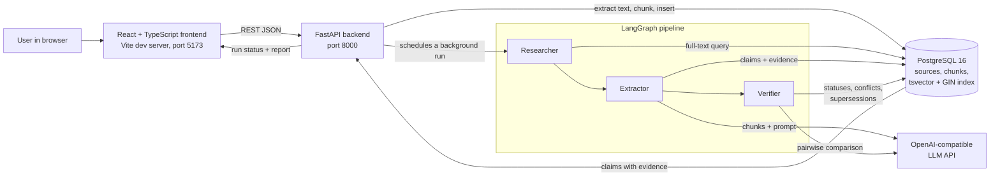

# AXIOM

**Every claim traceable. Every conflict visible. Every uncertainty stated.**

AXIOM is a document intelligence tool for teams whose decisions are scattered across
notes, specs, meeting minutes and PDFs. You upload the documents, ask a question, and
AXIOM answers with individual **claims** instead of prose — each claim carries the exact
quote it was drawn from, a label saying how far it can be trusted, and a pointer to the
document it came from. When two documents disagree, or when a newer document replaces an
older decision, AXIOM says so instead of quietly picking one.

## Overview

AXIOM ingests your team's text documents, splits them into searchable chunks, and runs a
three-stage pipeline over the chunks relevant to your question: a **Researcher** finds the
passages, an **Extractor** turns them into atomic claims with verbatim quotes, and a
**Verifier** checks each quote against its source and compares claims against each other.
The result is a report where every statement is labelled `verified`, `conflict`,
`uncertain` or `superseded`, and where you can always click back to the sentence that
produced it.

## Problem statement

In any project, the answer to "what did we decide?" lives in more than one document and
more than one point in time. A design doc says one thing, a later meeting note says
another, and a status update quietly contradicts both. A team member who reads the wrong
one builds the wrong thing.

Two failures follow from this, and neither is solved by ordinary search:

- **Currency.** Search returns every document that mentions a topic, with no indication
  which statement is the current decision and which has been replaced.
- **Disagreement.** A confident-sounding paragraph and a contradicting paragraph look
  identical in a search result list. Nothing in the interface says "these two sources
  disagree" — a reader has to notice it themselves, or not notice it at all.

LLM chat tools make this worse rather than better: they summarise the corpus into a
fluent answer with no visible per-statement evidence, so a reader cannot tell which part
of the answer came from which document, or that two documents conflicted at all.

## Proposed solution

AXIOM replaces the summarised answer with an evidence-backed claim graph:

1. **Ingest.** A document is uploaded, its text extracted, and split into overlapping
   chunks that are indexed with PostgreSQL full-text search.
2. **Research.** For a question, the Researcher retrieves the most relevant chunks.
3. **Extract.** The Extractor reads those chunks and returns atomic claims, each with a
   **verbatim quote** and the chunk id it came from.
4. **Verify.** The Verifier checks every quote actually appears in the cited chunk, then
   compares claims with each other: support from more than one source earns `verified`;
   a contradiction between sources earns `conflict`; an unsupported single-source
   statement stays `uncertain`; a newer document overriding an older one records a
   **supersession**.
5. **Report.** The report view lists every claim with its status, its quote, its source
   document, and the conflict/supersession relations it participates in — so a reader can
   audit each statement, not just trust the summary.

A quote that cannot be found in its cited chunk is dropped, so the report cannot contain a
claim whose evidence does not exist in the corpus.

## Key features

Only features that are implemented and working are listed here.

- **Document ingestion** for `.txt`, `.md` and `.pdf` files, with the extracted text split
  into overlapping chunks.
- **Full-text search** over those chunks using PostgreSQL's `tsvector` index.
- **Claim extraction with verbatim quotes**: every claim cites the chunk it came from and
  the exact sentence that supports it.
- **Quote verification**: quotes are checked against the source chunk (whitespace-normalised)
  and unverifiable claims are dropped.
- **Status labels**: `verified`, `conflict`, `uncertain`, `superseded`.
- **Conflict detection** between claims from different source documents.
- **Supersession detection** when a newer document replaces an earlier decision, with the
  old and new claims both recorded.
- **A report view with evidence**: per-claim status, notes, quote, source title, and the
  conflicts and supersessions the claim takes part in.
- **A synthetic demo**: one click loads four fictional documents and runs a preset
  question end to end, with an on-screen banner marking the data as synthetic.
- **A source library** showing every ingested document, its date, author and chunk count.
- **Readable failure states**: a failed run explains what went wrong (missing key, rate
  limit, timeout, backend down) instead of showing a raw HTTP body.

## Known limitations

These are real, current limitations — not roadmap items presented as finished work.

- **The demo does not show an `uncertain` claim from its open-issue document.** The
  synthetic "open issue" document (Doc D) is meant to surface an unresolved question, but
  because a second demo document states the same thing about search technology, the
  Verifier's mutual-support rule correctly labels Doc D's claim `verified` rather than
  `uncertain`. The `uncertain` status itself works and appears for genuinely
  single-source claims; it is simply not demonstrated by this particular demo corpus. The
  status rules were not bent to make the demo look better.
- **Scanned PDFs are rejected.** Extraction uses `pypdf`, which reads a PDF's text layer.
  A scanned or image-only PDF has no text layer and is rejected with a 422 and an OCR hint.
  OCR is out of scope.
- **There is no authentication or multi-user support.** AXIOM is a local, single-user tool:
  the API has no accounts, no per-user data separation, and CORS is limited to the two
  loopback frontend origins. It should not be exposed to the internet as-is.
- **Results depend on the LLM provider's output.** Claim wording, how many claims are
  extracted, and therefore which conflicts and supersessions are found, vary between
  models and between runs of the same model. The verifier's rules are deterministic, but
  its inputs are not. The demo was recorded over several runs; the supersession and the
  conflict appeared in every recorded run, but a different model may produce a different
  set of claims from the same documents.
- **One change can produce more than one supersession row.** Every contradicting
  old/new claim pair is stored, so the report may show several pairs describing the same
  change rather than one collapsed entry.
- **No pagination or virtualisation** in the source library; the corpora AXIOM was built
  for are small.

## Technologies used

| Layer | Technology |
| --- | --- |
| Frontend | React 19, TypeScript, Vite, React Router |
| Backend | FastAPI, Python 3.9 |
| Database | PostgreSQL 16 with full-text search (`tsvector` + GIN index) |
| Orchestration | LangGraph (Researcher → Extractor → Verifier) |
| Migrations | Alembic |
| LLM | Any OpenAI-compatible chat completions API |
| Infra | Docker Compose (database only) |

## Installation and setup

### Prerequisites

- **Docker** with Compose v2 (for PostgreSQL).
- **Python 3.9 or newer** (`python3 --version`).
- **Node.js 20.19+ or 22.12+** and npm (required by Vite 8; tested on Node 24.20).
- A key for an **OpenAI-compatible LLM API**. The model must be able to return JSON in a
  chat completion. Nothing else in the project needs an account or a paid service.

### 1. Clone the repository

```bash
git clone https://github.com/sruthikshailesh/Axiom.git
cd Axiom
```

### 2. Start the database

From the repository root:

```bash
docker compose up -d
```

This starts PostgreSQL 16 on `localhost:5432` with the database `axiom`, user `axiom`,
password `axiom`, in a named volume. Confirm it is ready with
`docker compose ps` (status `healthy`).

### 3. Install and configure the backend

```bash
cd backend
python3 -m venv .venv
source .venv/bin/activate        # Windows: .venv\Scripts\activate
pip install -r requirements.txt

cp .env.example .env
```

Now open `backend/.env` and set your key:

```ini
LLM_API_KEY=your_key_here
```

The other variables already have working defaults:

| Variable | Meaning |
| --- | --- |
| `DATABASE_URL` | Postgres connection string; matches the compose defaults. |
| `LLM_PROVIDER` | Only `openai` is implemented. |
| `LLM_API_KEY` | Your key. Never commit this file. |
| `LLM_MODEL` | Model name as your provider expects it. |
| `LLM_BASE_URL` | Optional; point at any OpenAI-compatible endpoint. Leave empty for the default. |

### 4. Create the tables

Still in `backend/` with the virtualenv active:

```bash
alembic upgrade head
```

### 5. Start the backend

```bash
uvicorn app.main:app --reload --host 127.0.0.1 --port 8000
```

Check it: <http://localhost:8000/health> should return `{"status":"ok","db":"ok"}`.

### 6. Install and start the frontend

In a second terminal, from the repository root:

```bash
cd frontend
npm install
npm run dev
```

## How to run

With the database container, the backend on port 8000 and the frontend on port 5173 all
running, open **<http://localhost:5173>** (use `localhost`, not `127.0.0.1:5173`: the
backend allows both, but keep one origin for the whole session so the saved last-run link
resolves).

- **Run the demo.** On the Query view, click **Load demo**. This inserts four synthetic
  documents into an empty database, starts a run with the preset question, and opens the
  report. The report shows a banner saying the data is synthetic, and the run takes
  roughly 20–60 seconds depending on the model. If `LLM_API_KEY` is missing or rejected,
  the run fails with a readable message rather than hanging.
- **Ask your own question.** Type a question on the Query view and press **Ask**. AXIOM
  retrieves matching chunks from whatever is already ingested.
- **Add your own documents.** Open **Sources**, choose a `.txt`, `.md` or `.pdf` file and
  click **Upload**. The file appears in the shelf with its chunk count. Ask a question
  afterwards to build a report over it.
- **Search the corpus directly.** `GET http://localhost:8000/search?q=deployment`
  returns the matching chunks with their ranks.
- **Revisit a report.** The report URL is `/runs/<id>`; the nav remembers the last run id
  you opened.

To stop, press `Ctrl+C` in both terminals and run `docker compose down` (add `-v` to drop
the database volume as well).

## Architecture



### Workflow

1. The user uploads a document. FastAPI extracts its text (`pypdf` for PDFs), splits it
   into overlapping chunks, and stores the chunks — PostgreSQL computes the `tsvector` for
   each one.
2. The user asks a question. `POST /runs` inserts a run row as `queued` and schedules the
   pipeline as a background task, so the request returns immediately; the frontend polls
   `GET /runs/{id}` once a second.
3. **Researcher** runs a full-text search for the question and keeps the top chunks
   (for the demo corpus it also makes sure every demo document is represented).
4. **Extractor** sends those chunks to the LLM, which returns one claim per chunk with a
   verbatim quote and a chunk citation. A coverage pass re-extracts any chunk the model
   skipped, so a retrieved source is never silently dropped.
5. **Verifier** checks each quote against its chunk, drops claims whose quote is not
   present, compares claims pairwise on shared topics, and assigns `verified`,
   `conflict`, `uncertain` or `superseded`, recording conflict and supersession rows.
6. The run is marked `completed` (or `failed` with a readable reason, including on timeout
   and on an interrupted backend restart).
7. The frontend renders the report: statuses, notes, quotes, source titles, conflicts and
   supersessions.

## Team members and contributions

- **Sruthik Shailesh** — solo developer: design, backend, frontend, pipeline, testing, and
  documentation.

## AI assistance

This project was built with AI coding assistants. An AI agent pair-programmed the
codebase with the developer, phase by phase: it drafted code, ran the test suite, drove
the browser checks, and wrote large parts of the documentation you are reading. The
developer directed each phase, reviewed the code and the changes, ran and verified the
application end to end, and is responsible for everything in the repository. Every feature
listed under **Key features** was executed and observed working; the gaps are listed under
**Known limitations** rather than described as done.

## Demo data notice

All four documents behind the **Load demo** button are **synthetic and fictional**, written
for this project to exercise the pipeline. "Lantern" is not a real product, the people
named in the documents are not real people, and the dates are invented. The report marks
these documents with an on-screen banner, and their titles are prefixed with
`[SYNTHETIC DEMO DATA]`. The `samples/` folder likewise contains test files used during
development, including one intentionally unreadable scanned PDF.
